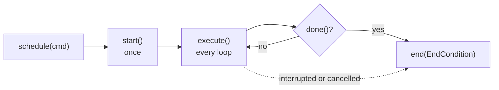
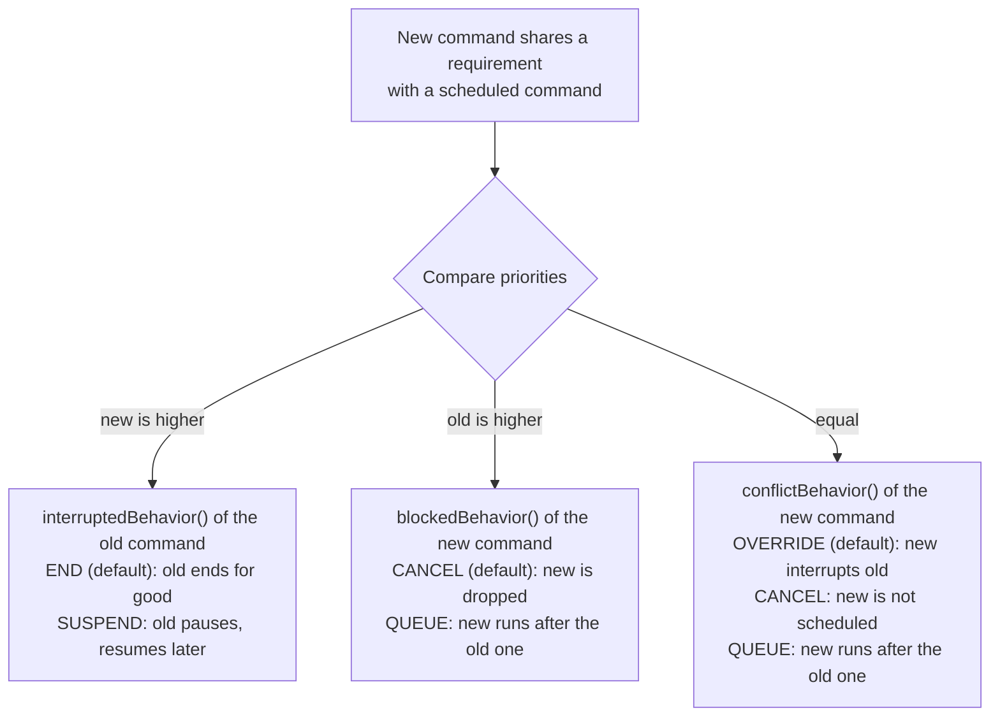
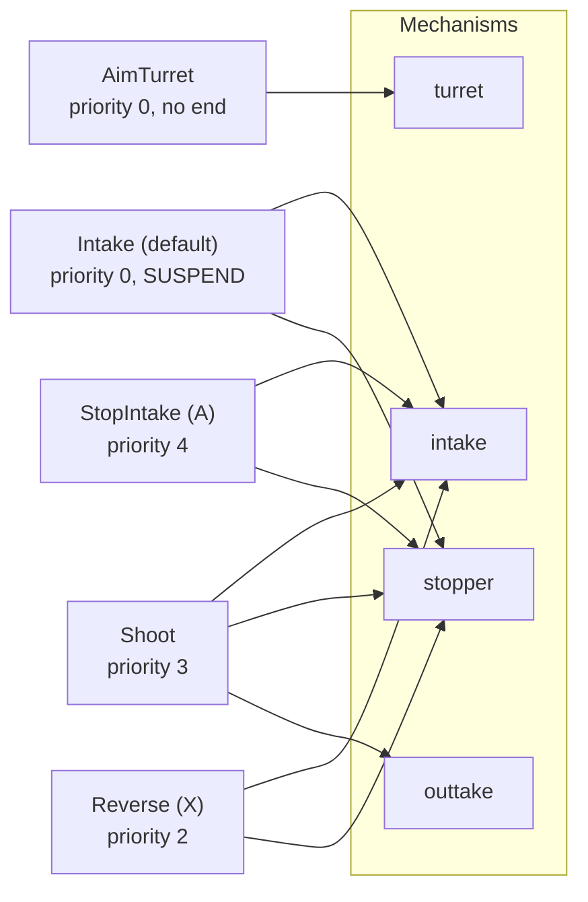

# TeleOp framework: next steps

Temporary planning document. Delete it when the plan is done.
Step numbers are kept from the first version. Steps 2, 3 and 4 were removed.

## Status

| Item | State |
|---|---|
| `Robot.clearBulkCache()` called every loop | Done |
| `TeleOpMode` base class with `onLoop()` hook | Done |
| Init flow in `Robot` (`init`, `initLoop`, `loop`) | Done |
| LB+RB re-initialize in `Robot.initLoop` | Done |
| Single `initialized` flag (set in `Robot.loop`) | Done |
| `UninitializeRobot` OpMode | Removed |
| Code compiled | Done. `JAVA_HOME="/Applications/Android Studio.app/Contents/jbr/Contents/Home" ./gradlew --offline :TeamCode:compileDebugJavaWithJavac` passes. |
| Field-centric drive in `MainTeleOp.onLoop()` | Done: a direct `follower.manual(...)` call. Pedro, not Ivy. |

## Next steps

| # | Step | Why | Size | Depends on |
|---|---|---|---|---|
| 1 | Build and fix compile errors | Done. No errors. | Small | none |
| 5 | `MechanismCommand` requirements and conflict behavior | **Deferred.** TeleOp mechanisms are manual, so no TeleOp need. Do it when Auto or TeleOp has two commands on one mechanism. | Small | none |
| 6 | `Controller.getPower` first-call D term | Divides by a tiny time on the first call | Small | none |
| 7 | Button bindings that schedule Ivy commands | **Dropped for now.** TeleOp mechanisms use plain `if` statements in `onLoop()`. | Medium | 5 |
| 8 | Logging per AGENTS rules | Log config at init, loop-time summary | Small | none |

---

## Step 5: Ivy refresher, then the `MechanismCommand` fix

Sources: Pedro Pathing docs, Ivy pages "Class API", "Requirements and Priorities", "Command Compositions". The docs do not list `EndCondition` values or describe `Scheduler` internals. This document does not guess them.

### Architecture

| Part | Role |
|---|---|
| `Command` | An interface. One unit of work with a lifecycle. |
| `Scheduler` | Static. `schedule(cmd)` adds a command. `execute()` runs one step of all commands. `reset()` clears them. Our OpModes call `execute()` every loop and `reset()` at init and stop. |
| Requirements | Objects a command claims, for example a motor or a mechanism. Optional. Default: none. |
| Priority | An `int`. Default 0. Decides who wins a requirement conflict. |
| Compositions | Helpers that build one command from many. |

### Command lifecycle



Defaults: `done()` returns `false` (the command never ends), `requirements()` is empty, `priority()` is 0.

### What happens when a new command shares a requirement



### Compositions

| Helper | Behavior |
|---|---|
| `sequential(a, b)` or `a.then(b)` | One after another |
| `parallel(a, b)` or `a.with(b)` | At the same time, ends when all end |
| `race(a, b)` or `a.raceWith(b)` | At the same time, ends when the first ends |
| `deadline(d, a, b)` | At the same time, ends when `d` ends |
| `repeat(cmd, n)` | Run `n` times |
| `loop(cmd)` | Restart forever; stop it with a race |

### Gap in `MechanismCommand`

| Method | Current value | Effect |
|---|---|---|
| `requirements()` | Empty set | Ivy sees no conflict. Two commands on one mechanism both run. |
| `conflictBehavior()` | `CANCEL` | After the fix, a new command on a busy mechanism would be **dropped**. |
| `priority()` | 0 | All commands are equal. |

Proposed fix:
- `requirements()` returns `Collections.singleton(mechanism)`. Do not use `Set.of`: the project compiles with Java 8 source.
- `conflictBehavior()` returns `OVERRIDE` (the Ivy default). The newest button press then wins and replaces the old target.

Without the second change, a button press would do nothing until the earlier command finished.

### Where requirements and priority help: DECODE `MainTeleOp`

Source: `two-eyed-illuminati/FTC-DECODE-2025-2026`, `TeleOp/MainTeleOp.java`. The Ivy behavior below comes from the Ivy docs. It is not tested on a robot.

**Example 1: the mode chain (lines 103-174).**
The code is one `if / else if` chain: `a`, then `right_trigger`, then `x`, then `b`, then a default "intake" branch. The order of the chain is the priority.

| Problem in the chain | What Ivy does instead |
|---|---|
| `Robot.aimOuttakeTurret(currDriveVel)` is copied into all 5 branches (lines 106, 124, 130, 135, 143). | One command that requires only `turret` runs all the time. No branch touches the turret. |
| Branch `a` (line 103) never sets the outtake. The flywheel keeps the setpoint of an earlier branch by accident. | The `a` command requires `{intake, stopper}`. The outtake command is not in conflict, so it keeps running. The code says this on purpose. |
| The priority is hidden in the order of the `else if` lines. | `priority()` is a number on each command. |
| The default "intake" branch is "whatever nothing else claimed". | The default command uses `SUSPEND`. It pauses when a stronger command takes its mechanism. It resumes when that command ends. |



Walkthrough with one input sequence:
1. Nothing pressed: `AimTurret` and `Intake` run.
2. Driver holds right trigger: `Shoot` (priority 3) beats `Intake` (priority 0). `Intake` is suspended. `AimTurret` does not conflict.
3. Driver also presses `x`: `Reverse` (priority 2) conflicts with `Shoot` (priority 3). The old command is stronger, so `blockedBehavior()` of `Reverse` applies. `CANCEL` drops it. This matches the original chain, where `right_trigger` wins over `x`.
4. Driver also presses `a`: `StopIntake` (priority 4) beats `Shoot`. `Shoot` ends.
5. Driver releases everything: `Intake` resumes.

**Example 2: the LED flash (lines 232-243).**
Three LED states (0, 1, 2) set the LED color. A white flash after a d-pad nudge must win for 0.1 seconds. The code adds `timeSinceLedFlashWhiteStart.seconds() > 0.1` to each of the three state branches. With Ivy:
- `LedState` requires `leds`, priority 0.
- `FlashWhite` requires `leds`, priority 1, ends after 0.1 seconds.
- `LedState` uses `SUSPEND`. It comes back by itself when the flash ends.

**Honest limit.** Ivy helps where two or more commands compete for one mechanism. The DECODE drive code has no such conflict. One command (`manual`) owns the drivetrain. The d-pad pose nudges (lines 200-231) also have no conflict. Do not wrap those in commands.

**What this means for the plan.** Step 5 is a small change (`requirements()` returns the mechanism). The benefit appears in step 7, when buttons schedule commands. Do step 7 only for mechanisms that more than one button can reach.

---

## Step 6: `Controller.getPower` first-call D term

Code: `utils/Controller.java`, method `getPower`.

```java
double power = feedforwardCoefficient * targetPos +
        pCoefficient * (targetPos-currPos) +
        dCoefficient * (targetPos-currPos - oldError) / timeSinceOld.seconds();
oldError = targetPos-currPos;
timeSinceOld.reset();
```

Variables: `error = targetPos - currPos`. `oldError` is the error at the last call. `dt` is `timeSinceOld.seconds()`, the time since the last call. The D term is `dCoefficient * (error - oldError) / dt`, the rate of change of the error.

**The problem.** `oldError` starts at `0` and `timeSinceOld` starts at the moment of construction. On the first call, the D term treats the whole error as a jump that happened in `dt` seconds. That is false. No previous sample exists.

| Case | Input | Result |
|---|---|---|
| First call, `Controller` built in the same tick | `error = 500`, `dt = 0.00002 s`, `dCoefficient = 0.0001` | D term = `0.0001 * 500 / 0.00002` = **2500**. The motor gets full power for one loop. |
| First call, `Controller` built at init, first call at start | Same `error`, `dt = 12 s` | D term = about `0.004`. The D term is small and wrong, but harmless. |
| Two calls in one loop | `dt` of a few microseconds | Same spike as the first row. |
| Controller idle for 10 s, then used again | `oldError` is 10 seconds old | The D term compares against a stale error and gives a wrong value. |

**Scope.** One-off change inside `Controller.java`. Callers do not change. `MotorMechanism.setPos` (line 48) and `ContinuousMotorMechanism.setPos` (line 35) call `controller.getPower` when a custom controller is set. Their Javadoc says `setPos` must be called every loop. If a mechanism skips `setPos` for a while (for example, another command owns it), the stale-error row in the table above applies. The same code exists in `FTC-DECODE-2025-2026` (`utils/PIDFController.java`, line 18), so that robot has the same spike.

**Proposed fix.** Skip the D term on the first call, and when `dt` is not positive:
- Add `boolean hasOldError = false`.
- If `!hasOldError`, use a D term of `0`.
- After each call set `hasOldError = true`.
- Optional: add a `reset()` that sets `hasOldError = false`. Call it when a mechanism starts a new command, so the stale-error case is covered.

---

## Libraries checked

Star counts were not found by web search. Check the repository pages.

| Library | Use | Stars | Note |
|---|---|---|---|
| NextFTC | Command-based framework, NextBindings for gamepad | Not found | Active; same idea as Ivy |
| SolversLib | FTCLib fork with `GamepadEx` | Not found | Maintained by team 23511 |
| Pedro + Ivy | Commands | Not found | Already in the project |

Recommendation: keep Pedro and Ivy. Copy the API shape of NextBindings if bindings are needed. Do not add a second scheduler.

## Questions and answers

(Add new questions and answers below this line.)

- Q: Should `AutoOpMode` and `TeleOpMode` share a base class?
  A: Open. Their `init`, `init_loop` and `stop` methods are now one-line calls to `Robot`. The saving is small.
- Q: Where would requirements and priority help, based on the DECODE repo?
  A: In the mode chain of `MainTeleOp` (lines 103-174) and the LED flash (lines 232-243). The drive and the d-pad nudges do not need them. See the "Where requirements and priority help" section in Step 5.
- Q: What is the issue in step 6?
  A: The D term of `Controller.getPower` divides by a very small `dt` on the first call and uses `oldError = 0`. This gives a spike. See Step 6 for the cases and the fix.
- Q: Would Ivy commands make the TeleOp architecture different from an FSM?
  A: Yes, in one way. An FSM has one global state. Ivy has one running command per mechanism, and the commands run at the same time. The DECODE mode chain is not a real FSM. It picks a mode again every loop from the buttons and keeps no state. A multi-step action (spin up, wait, open stopper, close) is a state machine. In Ivy it is a `sequential` command. Use an FSM state for a robot-wide mode with guards. Use commands for independent mechanisms. Log the running commands to telemetry, because there is no single state to show.
- Q: How do we expose SUSPEND? Example: a baseline "always run intake" command, and a reverse button that must pause it and then give it back.
  A: Ivy 1.1.1 already has the setters: `Command.build().requiring(x).setPriority(n).setInterruptedBehavior(SUSPEND)`. `MechanismCommand` hardcodes its behaviors today, so it needs matching setters. Test on the JVM (scheduler run with `core-1.1.1.jar`): a SUSPEND baseline gets `end(SUSPENDED)` when reverse starts and **resumes with `execute()` only, not `start()`**. The result is the same at equal priority and at higher priority. With END, the baseline gets `end(INTERRUPTED)` and never comes back. Consequences: (1) the baseline's `execute()` must set everything it needs, because `start()` does not run again; (2) the baseline must never be `done()`, but `MechanismCommand.done()` is `!running()`, so it needs an indefinite option; (3) a reverse command that lasts "while the button is held" needs `cancel()` on release.
- Q: Should TeleOp have no `onLoop()` and use only bindings?
  A: Mostly yes. Use bindings (`onPress`, `whileHeld`, `toggle`) for button actions. Use default commands (never done, `SUSPEND`) for continuous behavior such as drive and sensor-driven LEDs. The framework polls the bindings each loop before `Scheduler.execute()`. Each binding keeps its own previous value, so two bindings on one button do not race. Keep the empty `onLoop()` until nothing needs it. Log the running commands (step 8). Order: step 5, then the `bind(...)` helper (step 7), then drive as a default command.
- Q: Can TeleOp mechanisms be manual `if` statements, with only the drive as a separate piece?
  A: Yes. Decision: mechanisms are plain `if` statements in `onLoop()`. The drive stays as it is: a direct `follower.manual(ManualDrive.fieldCentric(...))` call. It is a Pedro call, not an Ivy command. Ivy runs only in Auto (`Scheduler.schedule(routine)`). Result: steps 5 and 7 are deferred. Revisit commands for multi-step actions (shoot sequence, timed LED flash), or when TeleOp must reuse an Auto action. Remaining: step 6 (`Controller` D term) and step 8 (logging). The Ivy notes in Step 5 stay as reference.
- Q: Does Roadrunner log anything by default? Does Pedro not?
  A: Correct for Pedro: `Follower.withLogger(...)` starts with an empty logger list, so Pedro writes nothing. Roadrunner (`ftc` 0.1.25, checked in the AAR bytecode): `FlightRecorder` implements `OpModeManagerNotifier.Notifications`. It writes `OPMODE_PRE_INIT`, `OPMODE_PRE_START` and `OPMODE_POST_STOP` events. The log file is `RoadRunner/logs/<yyyy_MM_dd__HH_mm_ss_SSS>__<opmode>.log` in the `LOG_ROOT` folder. It deletes old files by size. Its `MecanumDrive` also calls `FlightRecorder.write(...)` each loop (pose, commands, inputs). This repo has no Roadrunner dependency. Not verified: how `FlightRecorder` registers itself, and the exact `LOG_ROOT` base folder.
- Q: How does Roadrunner start servers for its tuning pages? Could we host a Pedro path visualizer?
  A: Roadrunner starts no server. It adds routes to the web server of the FTC SDK (the one behind the Robot Controller web page). Checked in the `ftc` 0.1.25 AAR bytecode: a static method with `@WebHandlerRegistrar` receives `(Context, WebHandlerManager)`. It calls `manager.register(path, WebHandler)`. The SDK finds the method at startup, so no OpMode code is needed. Routes: `/RoadRunner/tuning/<page>.html` and `/RoadRunner/tuning/latest.json` (static pages from the AAR `assets/web/`, plus the newest log file), `/logs` and `/logs/download` (list and download of `RoadRunner/logs`). Handlers use NanoHTTPD (`newChunkedResponse`). A Pedro visualizer needs the same three parts: a registrar method, a static HTML page in `TeamCode/src/main/assets/web/`, and a JSON route for the last path. Not yet checked: the `WebHandlerManager` API in SDK 12.0.0, and Panels (already a Pedro visualizer; `doc/PANELS_DEMO.md` mentions it).
- Q: How can the drive use Ivy for one-click go-to-location actions? (Repo: `biobuzz`.)
  A: Make the drive a never-ending `manual` command that requires a `DRIVE` key and uses `SUSPEND`. Make each go-to a `follow(...)` command that requires the same key. The press handler schedules a new go-to command each time, because the path starts at the current pose. JVM tests (`/tmp/ivycheck/D.java`, Ivy core 1.1.1): (1) the go-to suspends the manual command and the manual command resumes with `execute()` only after the go-to ends; (2) a second go-to cancels the first one (`end(INTERRUPTED)`) and takes over; (3) `cancel()` on the go-to gives control back to the manual command in the next loop. Equal priority is enough. `PedroCommands.follow` has no requirements and no `end` handler, so the code adds `requiring(DRIVE)`. Not tested on a robot.
