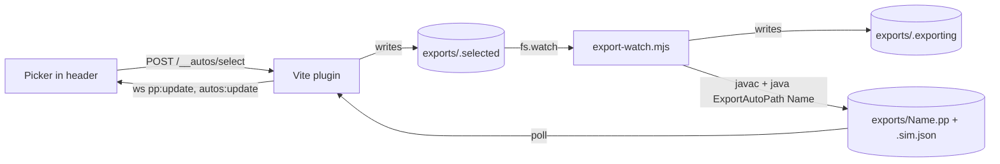

# Choosing an auto in the viewer

The header has a drop-down with every class in `auto/` that defines `static AutoBuilder createRoutine(Follower)`. Pick one and the viewer shows its path and simulation. No file dialog.



## Rules

| Topic                | Behavior                                                                                                               |
| -------------------- | ---------------------------------------------------------------------------------------------------------------------- |
| Class list           | Top-level `.java` files in `auto/` with a `static AutoBuilder createRoutine(` factory. Rescanned when `auto/` changes. |
| Output               | One file per class: `TeamCode/build/exports/<Name>.pp` (plus `.sim.json`, `.error`).                                   |
| Saving a source file | Re-exports only the selected auto. The others show **stale** in the menu until you pick them.                          |
| Picking an auto      | Re-exports it. The menu shows **exporting…** and a spinner meanwhile.                                                  |
| Persistence          | The choice lives in `exports/.selected`, so it survives reloads and restarts.                                          |
| Default              | `ExampleAuto` if present, otherwise the first auto alphabetically.                                                     |
| `PP_FILE=path`       | Old behavior. The watcher exports the selected class to that file, and the picker is hidden.                           |

## Menu badges

| Badge        | Meaning                                        |
| ------------ | ---------------------------------------------- |
| none         | Exported after the newest source change        |
| stale        | Some source in `auto/` is newer than its `.pp` |
| not exported | No `.pp` yet                                   |
| failed       | The last export wrote a `.error` file          |
| exporting…   | The watcher is exporting it now                |

## Command line

```
./gradlew :TeamCode:exportAutoPath -PppOutput=/tmp/red.pp -PppClass=RedAuto
```

Without `-PppClass` the class is `ExampleAuto`.
