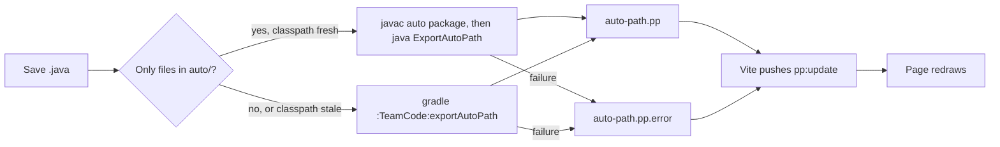

# Pedro Path Viewer

View-only viewer for the autonomous path built in Java. Edit `ExampleAuto.java`, save, and the page redraws. Based on the Pedro Visualizer (Apache-2.0, see `LICENSE` and `NOTICE`).

## Start

```sh
cd tools/viewer && pnpm install && pnpm dev
```

Open http://localhost:5173. `pnpm dev` starts the Vite server and the export watcher together.

Other commands:

```sh
PP_FILE=TeamCode/build/exports/other.pp pnpm dev
pnpm dev:viewer
pnpm export:watch
pnpm check && pnpm test && pnpm build
```

- `PP_FILE`: the `.pp` to show, relative to the repo root. The default is `TeamCode/build/exports/auto-path.pp`.
- `pnpm dev:viewer`: viewer only. It shows whatever `PP_FILE` holds.
- `pnpm export:watch`: watcher only.

## How it works



- At startup the watcher runs one full Gradle export (about 15 s). That export builds the classes the fast path links against. It then caches the Gradle classpath in `TeamCode/build/exports/.export-classpath`.
- The fast path compiles every `.java` file in the `auto` package. It takes about 1 s in total.
- The watcher uses full Gradle when a changed file is outside `auto/`, or when a Gradle file changes.
- A failed export keeps the last good drawing. The page shows the compiler output in a banner.
- A missing or invalid `.pp` shows an error banner.
- The watcher sets `ANDROID_HOME` to `~/Library/Android/sdk` when it is not set.

## Controls

- Wheel: zoom about the cursor.
- Drag: pan.
- Double-click: reset the view.

## Limits

- The viewer does not simulate speed, acceleration or braking. It draws the geometry only.
- Robot size comes from the `robot` key of the `.pp`. The default is 16 x 16 in.
- Layer choices are not saved between reloads.
